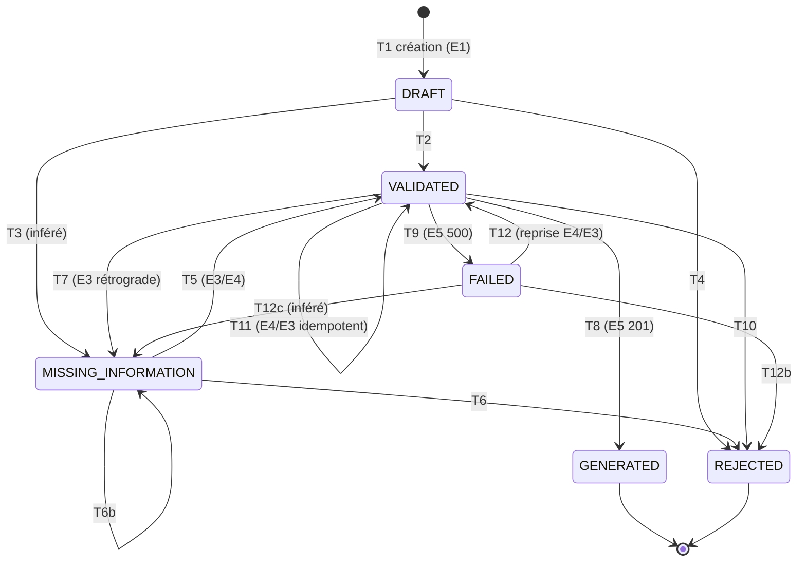
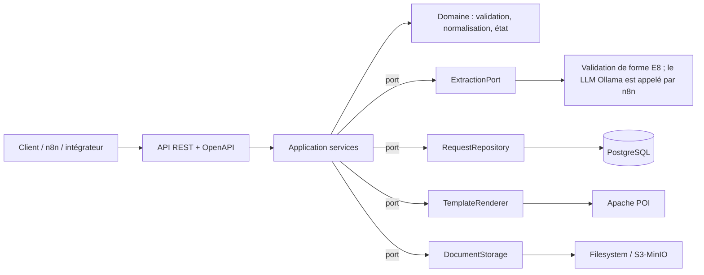

# PRD — Document Generator (adgendoc) — v2.2

**Version :** 2.2 (corrections issues de l'audit G0 backend ; voir la ligne « Changements v2.1 → v2.2 » ci-dessous) — v2.1 : révision du PRD v1.0 du 23/10/2026, optimisée pour Cursor AI ; **alignée sur `API_CONTRACTS.md` (v1) et `N8N_CONTRACTS.md` (v1)**
**Changements v2.1 → v2.2 :** (1) §12.1 : le 400 de E8 a pour corps `ExtractionValidationResponse` (API_CONTRACTS l.440), pas `ErrorResponse` ; (2) FR-06 : motif de placeholder à confirmer sur le template réel (le moteur traite `{{…}}`) ; (3) commandes : le wrapper Maven est absent du dépôt → `mvn` ou lot d'ajout du wrapper ; (4) §10 : Spring Boot 3.3.13 est hors support OSS, migration planifiée par ADR ; (5) les `*IT` ne sont pas exécutés par Surefire par défaut → Failsafe requis ; (6) la classe `RequestStateMachine` reste une proposition : la matrice de transitions existe dans `RequestStatus`.
**Changements v2 → v2.1 :** machine à états réelle (§8) ; mapping erreurs rempli depuis les contrats (§12) ; section d'incohérences des contrats (§12.3) ; retrait des propositions contraires aux contrats (ProblemDetail, JWT/RBAC en it.1, `Idempotency-Key`) ; extraction IA alignée sur E8/Ollama (§11)
**Statut :** Projet existant (Java / Spring Boot) — stabilisation incrémentale, **pas de réécriture**
**Produit :** Génération contrôlée de documents administratifs à partir de demandes structurées et de données extraites par IA
**Premier cas métier :** `ATTESTATION_CONCORDANCE`

---

## 0. Mode d'emploi (lire en premier — humains et agents)

### 0.1 Légende des statuts

Chaque élément de ce document porte un statut. **Cursor ne doit jamais traiter un « Proposé » comme un fait établi.**

| Tag | Signification |
|---|---|
| `[EXISTANT]` | Établi par le dépôt ou les contrats sources (à vérifier à l'audit G0) |
| `[À CONFIRMER]` | Probablement présent, non vérifié |
| `[PROPOSÉ]` | Ajout de cette v2 ; à valider (ADR) avant implémentation |
| `[DÉCISION]` | Question ouverte nécessitant un arbitrage humain |

### 0.2 Ordre de priorité des sources de vérité

1. `requirements/API_CONTRACTS.md`, `requirements/N8N_CONTRACTS.md` et `requirements/ATTESTATION_CONCORDANCE.md` (contrats ; **tous deux marqués « PROPOSÉ » — à valider par l'humain avant de les figer**)
2. Migrations Flyway (modèle de données réel)
3. Code et tests existants
4. ADR et `docs/architecture.md`
5. **Ce PRD** (en cas de conflit avec 1–4, les sources 1–4 gagnent ; signaler l'écart, ne pas le corriger silencieusement)

### 0.3 Règles d'or pour l'agent

- Ne jamais recréer le projet, ne jamais renommer les endpoints, statuts ou codes d'erreur existants.
- Un changement = une portée = des tests = un rapport. Pas de refactoring mélangé à une correction.
- Un gate non exécuté vaut `NOT_RUN`, jamais `PASS`.
- Avant tout accès réseau, Docker, base de données, n8n ou fournisseur IA : demander l'accord.
- Aucun secret, aucune PII réelle dans le code, les fixtures, les logs ou les rapports.
- Préserver les fichiers non suivis (`=ro`, `opencode.json`, fixtures).

---

## 1. Résumé exécutif

adgendoc est un backend de production de documents administratifs. Parcours cible :

**demande → extraction IA structurée → validation déterministe → normalisation → persistance PostgreSQL → sélection du modèle DOCX → génération DOCX → stockage → récupération**

**Principe directeur :** l'IA *propose*, le code déterministe *décide*. L'extraction est probabiliste ; la validité métier, la traçabilité et la génération ne le sont jamais.

**Objectif de cette phase :** stabiliser l'existant, terminer la couverture contractuelle et démontrer un parcours de bout en bout reproductible (local et CI).

## 2. Problème, utilisateurs, opportunité

La rédaction manuelle est lente, hétérogène et source d'erreurs de saisie. L'IA accélère l'extraction mais ne doit jamais trancher seule sur la validité d'un document.

| Persona | Besoin principal | Interaction |
|---|---|---|
| Agent administratif / opérateur | Produire un document correct sans ressaisie | API via n8n ou client interne |
| Responsable de validation métier | Revue des demandes `REJECTED` / `MISSING_INFORMATION` ; validation humaine **non couverte par les contrats it.1** (Q-07) | `[DÉCISION]` |
| Intégrateur API | Contrat stable, erreurs typées, idempotence | OpenAPI, environnement de test |
| Administrateur technique | Observabilité, déploiement, purge, rotation des secrets | Logs, métriques, runbook |

Hors périmètre MVP : interface citoyenne.

## 3. Objectifs et indicateurs

| Objectif | Critère d'acceptation | Indicateur `[PROPOSÉ]` |
|---|---|---|
| Générer une attestation | Demande valide → DOCX récupérable, **0 placeholder résiduel** | Taux de génération réussie |
| Prévenir les erreurs | Validation déterministe avant toute génération | Taux de rejets par code d'erreur |
| Traçabilité | Chaque transition et erreur est auditée avec `requestId` | 100 % des transitions auditées |
| Entrées incomplètes | `MISSING_INFORMATION` + liste exacte des champs | Taux de demandes incomplètes |
| Maîtrise des pannes | Erreurs typées, retries bornés, pas de doublons | Taux d'erreurs par étape |
| Reprise sous Cursor | Baseline reproductible, PR petites et vérifiables | Tests passants en CI |

Cibles chiffrées `[DÉCISION]` à fixer **après mesure de référence** (voir NFR §7) — hypothèses de départ : génération DOCX P95 < 3 s hors appel IA ; extraction IA P95 < 15 s avec timeout dur à 30 s.

## 4. Périmètre

### 4.1 MVP `[EXISTANT]` / `[À CONFIRMER]`

- Type `ATTESTATION_CONCORDANCE` uniquement.
- Extraction IA vers un schéma canonique ; rejet des clés inconnues (`ERR_CHAMP_INCONNU`).
- Validation déterministe, normalisation ; dates canoniques ISO `YYYY-MM-DD` (`dd/MM/yyyy` réservé aux entrées/présentations si le contrat le prévoit ; `ERR_DATE_FORMAT_INVALIDE`).
- Statuts `DRAFT` / `MISSING_INFORMATION` / `VALIDATED` / `REJECTED` / `GENERATED` / `FAILED` (§8). `REQUIRES_BUSINESS_VALIDATION` n'existe dans aucun contrat : hors MVP sauf décision (Q-07).
- Persistance des demandes et événements d'audit (PostgreSQL + Flyway).
- Template `attestation_concordance_v1.docx`, génération (Apache POI), stockage, récupération.
- Huit endpoints REST **E1–E8** définis par `API_CONTRACTS.md` (base `/api/v1`) — **à reprendre tels quels** :

| ID | Méthode / chemin | Objet |
|---|---|---|
| E1 | `POST /requests` | Créer + valider (201 VALIDATED · 400 REJECTED/enveloppe · 422 MISSING_INFORMATION · 413) |
| E2 | `GET /requests/{id}` | État de la demande |
| E3 | `PATCH /requests/{id}` | Complétion partielle par fusion + recalcul du statut |
| E4 | `POST /requests/{id}/validate` | Revalidation idempotente |
| E5 | `POST /requests/{id}/generate` | Génération DOCX synchrone (201) |
| E6 | `GET /requests/{id}/documents/{docId}` | Téléchargement DOCX |
| E7 | `GET /health` | Santé (200 UP / 503 DOWN) |
| E8 | `POST /extraction/validate` | Contrôle de **forme** du JSON d'extraction IA |

Conventions : `X-Correlation-Id` optionnel en entrée (UUID v4 généré sinon), renvoyé partout ; `Content-Type: application/json; charset=UTF-8` obligatoire sur les POST/PATCH ; corps max 65 536 octets (`413`) ; **authentification hors périmètre it.1** (réseau interne/localhost), JWT en it.2.
- Tests unitaires/intégration + script E2E HTTP à auditer.

### 4.2 Orchestration n8n (chantier en cours)

- Webhook `POST /webhook/document-generation` (corps `{message, requestId?}`, clés racine inconnues → 400) ; enveloppe de réponse `{outcome, correlationId, …}` ; **200 = résultat métier**, 4xx = entrée client, 5xx = panne technique.
- Collecte multi-tours (`MAX_CLARIFICATION_ROUNDS = 5`, `requestId` obligatoire dès le round 2), clarification des champs manquants, appels backend E1–E8, vérification du document (E6) **sans relais du binaire**.
- Extraction par LLM local **Ollama** ; budget ≤ 19 appels LLM+backend par exécution ; `EXECUTIONS_TIMEOUT` 900 s.
- Scénarios I-C et I-D (voir §14). **Gates runtime I-B/I-C/I-D non prouvées** ; les fixtures statiques ne valent pas preuve runtime.

### 4.3 Hors périmètre

Multi-types en production, signature électronique, paiement, portail public, OCR universel, workflow d'approbation complet, cloud de production, migration de framework. Toute fonctionnalité absente des contrats exige une décision explicite (ADR).

## 5. Parcours (avec critères Given/When/Then)

**P1 — Demande valide**
- *Given* une demande conforme au contrat, *when* elle est soumise, *then* un DOCX est généré, stocké, lié à la demande et récupérable via l'API ; l'état final est `GENERATED`.

**P2 — Données incomplètes**
- *Given* des champs obligatoires absents, *when* la validation s'exécute, *then* la réponse est `MISSING_INFORMATION` avec la liste **exacte** des champs ; *and* une complétion sur la même demande reprend le flux (si le contrat l'autorise) ; *and* l'outcome n8n `CLARIFICATION_LIMIT_REACHED` est émis au 5ᵉ round.

**P3 — Données invalides**
- *Given* une date non conforme ou une clé inconnue, *then* aucun document n'est généré, le code d'erreur est exploitable, aucune donnée sensible n'est exposée.

**P4 — Rejet métier**
- *Given* une règle métier violée, *then* `REJECTED` (statut terminal) avec `fieldErrors[]` ; l'IA ne peut pas contourner ce contrôle.

**P5 — Échec technique**
- *Given* IA indisponible, backend indisponible, timeout ou erreur de génération, *then* réponse typée, retries bornés, demande et audit intègres, statut backend `FAILED` (outcome n8n `GENERATION_FAILED`) le cas échéant, reprenable via E4/E3.

**P6 — Idempotence**
- *Given* une requête E4 ou E3 répétée, *then* le résultat est identique (idempotence contractuelle) ; *given* un E5 en timeout, *then* n8n réconcilie par E2 avant toute décision et ne lance **jamais un 3ᵉ appel E5** ; *given* un E1 en timeout, *then* aucun retry automatique (doublon possible tracé `F-I-1`, réconciliable par `correlationId`).

## 6. Exigences fonctionnelles

| ID | Prio | Exigence | Acceptation vérifiable |
|---|---|---|---|
| FR-01 | P0 | Accepter une demande ATTESTATION_CONCORDANCE | Payload conforme ; 4xx typé sinon |
| FR-02 | P0 | Extraire vers un schéma canonique | JSON Schema validé ; clés inconnues rejetées |
| FR-03 | P0 | Valider sans dépendre de l'IA | Tests unitaires (obligatoires, dates, règles métier) sans appel IA |
| FR-04 | P0 | Normaliser | ISO 8601 ; transformations déterministes et idempotentes |
| FR-05 | P0 | Persister demande + audit | Transaction cohérente ; références stables |
| FR-06 | P0 | Générer le DOCX depuis un template versionné | 14 placeholders remplacés ; 0 motif de placeholder résiduel (syntaxe réelle du template, `{{…}}` d'après le moteur — `[À CONFIRMER]` sur le fichier .docx) ; fichier ouvrable |
| FR-07 | P0 | Stocker et récupérer | Document lié à la demande ; contrôle d'accès |
| FR-08 | P0 | Exposer les endpoints contractuels | Tests de contrat HTTP verts contre `API_CONTRACTS.md` |
| FR-09 | P1 | Complétion multi-tours | `missingFields` cohérents ; transitions conformes |
| FR-10 | P1 | Distinguer issues métier / techniques | Mapping statut ↔ HTTP ↔ `code` (§12.1) et outcome n8n ↔ HTTP (§12.2) testés |
| FR-11 | P1 | Résister aux doublons et pannes | Tests doublons, retry, timeout |
| FR-12 | P1 | Couvrir I-C / I-D en fixtures | Validateur statique et tests adversariaux verts |
| FR-13 | P1 | Prouver les gates runtime n8n | Exécution autorisée + rapport de preuves |
| FR-14 | P2 | Préparer d'autres types documentaires | Contrat de template extensible sans impact MVP |
| FR-15 | P1 `[PROPOSÉ]` | Intégrité du template | Empreinte SHA-256 du template enregistrée avec chaque document généré |
| FR-16 | P2 `[PROPOSÉ]` | Purge / rétention | Job de purge conforme à la politique §10 |

## 7. Exigences non fonctionnelles `[PROPOSÉ]`

| ID | Catégorie | Exigence |
|---|---|---|
| NFR-01 | Performance | Mesurer d'abord (G1/G4), puis fixer P50/P95 par étape ; budget initial §3 |
| NFR-02 | Résilience | Timeouts explicites sur chaque appel sortant ; retries bornés avec backoff + jitter ; circuit breaker sur l'IA |
| NFR-03 | Idempotence | E3/E4 idempotents (contrat) ; verrou optimiste `@Version` sur la demande (finding `F-I-3`, `[À CONFIRMER]`) ; **E1 n'a pas de clé d'idempotence** : en ajouter une est un changement de contrat → `[DÉCISION]` it.2, additif et rétrocompatible |
| NFR-04 | Observabilité | Logs JSON structurés, `requestId` en MDC, métriques par étape, traces distribuées, **sans PII** |
| NFR-05 | Reproductibilité | `docker compose up` + `mvn verify` (ou `./mvnw verify` une fois le wrapper ajouté, `[PROPOSÉ]`) suffisent à rejouer tout le parcours ; pas de dépendance à PowerShell seul |
| NFR-06 | Portabilité | Tests exécutables Windows/Linux/CI (scripts `.ps1` doublés d'un équivalent bash ou d'un test Java) |
| NFR-07 | Maintenabilité | Architecture hexagonale vérifiée par ArchUnit ; couverture JaCoCo ≥ 80 % sur domaine et validation |
| NFR-08 | Sécurité | OWASP ASVS niveau 2 comme référence ; dépendances et images scannées en CI |

## 8. Modèle de domaine et machine à états

Tables et colonnes réelles : **dérivées des migrations Flyway**, jamais inventées. Entités logiques `[À CONFIRMER]` : `document_request` (nom cité par les contrats), `NormalizedData`, `GeneratedDocument`, `AuditEvent`, référence de template.

**Données (`data`, `additionalProperties: false`)** — clés camelCase : `prenom`, `nom`, `dateNaissance`, `lieuNaissance`, `nomIncorrect`, `nomCorrect`, `sexe`, `nationalite`, `documentSourceReference`, `langueDocument`, `demandeur`, `contactEmail`, `contactTelephone`, `motif`. `referenceDemande` est **interdit** dans `data` (réservé système, `ERR_CHAMP_RESERVE`). Champs `null`/vides = **absents**.
**6 champs obligatoires** (`ExtractionResult`, §11) : `prenom`, `nom`, `dateNaissance`, `lieuNaissance`, `nomIncorrect`, `nomCorrect` `[À CONFIRMER dans ATTESTATION_CONCORDANCE.md §3]`.

**Template :** `templates/attestation_concordance_v1.docx` — 14 placeholders en snake_case : `prenom`, `nom`, `date_naissance`, `lieu_naissance`, `nom_incorrect`, `nom_correct`, `sexe`, `nationalite`, `document_source_reference`, `langue_document`, `demandeur`, `motif`, `reference_demande`, `date_generation`. Les clés `data` sont en camelCase : prévoir un **mapping explicite et testé** clé → placeholder ; `reference_demande` et `date_generation` sont fournis par le système ; `contactEmail` / `contactTelephone` ne sont pas dans le template (PII stockée mais non rendue — voir minimisation §13).

**Statuts (enum du contrat §1.2) :** `DRAFT` (interne, création uniquement) · `MISSING_INFORMATION` · `VALIDATED` · `REJECTED` (**terminal**) · `GENERATED` (**terminal**) · `FAILED` (reprenable).

**Machine à états** — reconstituée depuis les contrats ; les numéros T1–T14 sont définis dans `ATTESTATION_CONCORDANCE.md` §9 (non fourni) : **à confirmer**.



Interdits (→ `409`) : E4 depuis `GENERATED`/`REJECTED` (T13/T14, `INVALID_STATUS`) ; E3 depuis `GENERATED`/`REJECTED` (`REQUEST_ALREADY_CLOSED`) ; E5 depuis tout statut ≠ `VALIDATED` (`INVALID_STATUS`).

Règle : la matrice de transitions existe dans `RequestStatus` (audit G0) ; elle est verrouillée par un test statut × endpoint (transitions autorisées et interdites). Une classe dédiée `RequestStateMachine` reste une PROPOSITION `[PROPOSÉ]`, à n'envisager qu'après ce test. Chaque transition écrit un `AuditEvent` dans la même transaction `[À CONFIRMER : non prouvé par l'audit G0]`. **Le fait que `REJECTED` soit terminal est une décision produit à rediscuter** (voir §12.3, Q-04).
## 9. Architecture

**Style `[PROPOSÉ]` :** hexagonale (ports & adapters), cohérente avec « ports/adapters, mappers et conventions d'erreur déjà définis ».



Règles : le domaine n'importe ni Spring, ni JPA, ni POI, ni client IA ; les contrôleurs ne contiennent aucune logique métier ; chaque dépendance externe (IA, stockage, rendu) est derrière un port avec un **stub** pour les tests.

## 10. Stack technique

| Domaine | Choix | Statut | Justification |
|---|---|---|---|
| Langage | Java 17 actuel (`pom.xml`) ; Java 21 LTS cible | `[DÉCISION]` | Une seule version sur tous les modules et la CI ; décision liée à la migration Spring Boot |
| Framework | Spring Boot 3.3.13, Maven (wrapper **absent**), POI 5.2.5 | `[EXISTANT]` (audit G0) | **3.3.13 = dernière version OSS de la branche 3.3** : migration vers une branche supportée à planifier par ADR, **après** les tests de contrat qui servent de filet |
| Base | PostgreSQL + Flyway | `[EXISTANT]` | Migrations versionnées ; **aucune modification d'une migration déjà appliquée** |
| DOCX | Apache POI (`XWPF`) | `[EXISTANT]` | Gérer les placeholders éclatés en plusieurs *runs* (cause classique de résidus) |
| Orchestration | n8n | `[EXISTANT]` | — |
| Contrat API | springdoc-openapi + `openapi.yaml` versionné | `[PROPOSÉ]` | Contrat exécutable, base des tests de contrat |
| Erreurs HTTP | `ErrorResponse` du contrat (`code`, `message`, `correlationId`, `missingFields[]`, `requestId?`, `status?`, `fieldErrors[]`) | `[EXISTANT]` | **Ne pas adopter `ProblemDetail`** : un second format casserait le contrat (corrigé vs v2.0) |
| Validation | Jakarta Validation + règles métier dédiées | `[PROPOSÉ]` | Séparation syntaxe / règles métier |
| Validation schéma IA | networknt `json-schema-validator` | `[PROPOSÉ]` | Rejet strict des sorties IA non conformes |
| Appel IA | **L'appel LLM est fait par n8n** (Ollama `POST /api/chat`, ex. `llama3.1`), pas par le backend ; le backend ne reçoit que `extraction.{confidence, modelId, promptVersion}` (audit) | `[EXISTANT]` | Pas de client IA dans Spring en it.1 ; stub Ollama (WireMock) pour les tests n8n |
| Résilience | Resilience4j (timeout, retry, circuit breaker, bulkhead) | `[PROPOSÉ]` | NFR-02 |
| Mapping | MapStruct | `[PROPOSÉ]` | Mappers explicites, vérifiés à la compilation |
| Sécurité | **It.1 : aucune authentification** (réseau interne / loopback) ; **it.2 :** Spring Security JWT (`401 UNAUTHORIZED`, `403 FORBIDDEN`) sur tout sauf `/health` | `[EXISTANT]` (décision de contrat) | Obligations avant production : jeton webhook n8n (`F-I-6`) **et** autorisation du téléchargement E6 (R-10 / OQ-API-4) |
| Stockage | Port `DocumentStorage` : filesystem local → S3 compatible (MinIO) | `[PROPOSÉ]` | Chiffrement au repos, empreinte SHA-256 |
| Observabilité | Micrometer + Prometheus, OpenTelemetry, logs JSON (Logback) | `[PROPOSÉ]` | NFR-04 |
| Tests | JUnit 5, AssertJ, Mockito, MockMvc/REST Assured | `[EXISTANT]` à confirmer | — |
| Tests d'intégration | Testcontainers (PostgreSQL), WireMock (IA, n8n) | `[PROPOSÉ]` | Environnement isolé, sans Docker manuel |
| Tests de contrat | Validation OpenAPI en test + Schemathesis | `[PROPOSÉ]` | Détecte les dérives de contrat |
| Tests d'architecture | ArchUnit | `[PROPOSÉ]` | Protège l'hexagone contre les dérives de l'agent |
| Qualité | Spotless, Checkstyle, SpotBugs, JaCoCo, PIT (mutation, sur domaine) | `[PROPOSÉ]` | Garde-fous automatiques pour le code généré par IA |
| Sécurité supply chain | OWASP Dependency-Check, Trivy, Gitleaks, Dependabot/Renovate | `[PROPOSÉ]` | Scan dépendances, image, secrets |
| Conteneurs | Docker Compose avec réseau interne `adgendoc-internal`, n8n publié sur `127.0.0.1:5678` | `[EXISTANT]` (cité par N8N_CONTRACTS §1.3) ; Dockerfile multi-stage / MinIO `[PROPOSÉ]` | NFR-05 |
| CI | GitHub Actions (ou équivalent) : build, tests, qualité, scans, rapport de gates | `[PROPOSÉ]` | Rendre les gates reproductibles |

**Rétention et RGPD `[DÉCISION]` :** les attestations contiennent des données d'identité. Définir : base légale, durée de conservation, purge automatique, droit d'accès/effacement, journalisation des accès, chiffrement au repos et en transit, sous-traitance IA (un fournisseur IA externe reçoit des données personnelles → hébergement UE ou modèle local obligatoire par défaut).

## 11. Extraction IA (contrat réel)

**Frontière :** n8n appelle le LLM (Ollama) ; le backend **ne fait jamais confiance** à la sortie IA. `extraction.confidence` est une métadonnée d'audit qui **n'influence jamais** la validation.

**`ExtractionResult` (E8)** : `{documentType, confidence ∈ [0,1], data{…}, missingFields[]}` — `additionalProperties: false` ; `dateNaissance` **strictement ISO `yyyy-MM-dd`** (un `dd/MM/yyyy` est rejeté par E8 ; E1 le tolère en entrée et le normalise) ; `missingFields` ⊆ clés obligatoires et re-déclare **toutes** les clés obligatoires encore absentes (règle `allOf`, invariant de chaque round). L'IA **signale** les absences, ne les comble jamais.

**Chaîne :** LLM → E8 (forme) → [garde D-1 déterministe, `ATTESTATION_CONCORDANCE.md` §6.1] → E1/E3 (validation métier) → statut.

**Discrimination des rejets E8 :** `ERR_DOCUMENT_TYPE_NON_SUPPORTE` → outcome `200 UNSUPPORTED_DOCUMENT_TYPE` ; tout autre `400` E8 → `502 EXTRACTION_SCHEMA_INVALID`. `AI_EXTRACTION_ERROR` (502) = LLM injoignable / sortie non JSON, **jamais** un rejet E8.

**Exigences complémentaires `[PROPOSÉ]` :** prompt versionné dans le dépôt (`promptVersion`) ; température basse ; texte utilisateur traité comme donnée (anti-injection) ; aucune sortie LLM brute dans logs/réponses ; corpus de test 100 % synthétique ; évaluation du modèle en job séparé non bloquant.
## 12. Statuts, erreurs et mapping (extraits des contrats)

### 12.1 Backend — endpoint × HTTP × `code`

| HTTP | `ErrorResponse.code` | Endpoints | Persistance / effet |
|---|---|---|---|
| 200 | — | E2, E3, E4, E7, E8 | E3 : statut **recalculé** (`VALIDATED`, `MISSING_INFORMATION`, `FAILED`→reprise) |
| 201 | — | E1 (`VALIDATED`), E5 (`GENERATED`) | persisté |
| 400 | `VALIDATION_ERROR` + `fieldErrors[]` | E1, E3, E4 (**E8 : corps `ExtractionValidationResponse`**, API_CONTRACTS l.440) | **Enveloppe invalide** (JSON malformé, `documentType` inconnu, clé racine inconnue, `Content-Type` ≠ JSON) → **non persisté**. **Règle métier violée dans `data`** (ex. `ERR_DATE_FUTUR`, `ERR_NOM_CONCORDANCE_IDENTIQUE`, clé inconnue dans `data` à la création) → persisté `REJECTED` + `requestId`. E3 : clé inconnue/réservée (`ERR_CHAMP_INCONNU`/`ERR_CHAMP_RESERVE`) → **aucune mutation**, jamais `REJECTED` |
| 401 / 403 | `UNAUTHORIZED` / `FORBIDDEN` | tous sauf E7 | **it.2 seulement** |
| 404 | `REQUEST_NOT_FOUND` / `DOCUMENT_NOT_FOUND` | E2–E6 | — |
| 409 | `INVALID_STATUS` | E4, E5 | statut source interdit |
| 409 | `REQUEST_ALREADY_CLOSED` | E3 | `GENERATED` ou `REJECTED` |
| 413 | `VALIDATION_ERROR` | tout endpoint à corps | > 65 536 octets, non persisté |
| 422 | `MISSING_INFORMATION` + `missingFields[]` | E1, E4 | persisté `MISSING_INFORMATION` (E3 renvoie **200** avec ce statut, pas 422) |
| 500 | `TEMPLATE_NOT_FOUND` / `DOCUMENT_GENERATION_ERROR` | E5 | → `FAILED` (T9), `correlationId` obligatoire |
| 500 | `DATABASE_ERROR` / `INTERNAL_ERROR` | tous | — |
| 503 | `HealthResponse.status = DOWN` | E7 | base indisponible |

Codes de champ à préserver : `ERR_PAYLOAD_INVALIDE`, `ERR_DOCUMENT_TYPE_NON_SUPPORTE`, `ERR_CHAMP_INCONNU`, `ERR_CHAMP_RESERVE`, `ERR_CHAMP_OBLIGATOIRE_ABSENT`, `ERR_DATE_FORMAT_INVALIDE`, `ERR_DATE_CALENDRIER_INVALIDE`, `ERR_DATE_FUTUR`, `ERR_NOM_CONCORDANCE_IDENTIQUE` (liste exhaustive : `ATTESTATION_CONCORDANCE.md` §10.2, `[À CONFIRMER]`).

### 12.2 Webhook n8n — outcome × HTTP

| HTTP | `outcome` | `error.code` | Cause |
|---|---|---|---|
| 200 | `GENERATED` | — | E5 201 + E6 200 |
| 200 | `MISSING_INFORMATION` | — | E1 422 / E3 200 / E4 422 |
| 200 | `REJECTED` | — | 400 backend persistant en `REJECTED` |
| 200 | `GENERATION_FAILED` | — | E5 500 persistant après récupération bornée (`status = FAILED`, `cause`) |
| 200 | `UNSUPPORTED_DOCUMENT_TYPE` | — | E8 400 `ERR_DOCUMENT_TYPE_NON_SUPPORTE` |
| 200 | `CLARIFICATION_LIMIT_REACHED` | — | 5ᵉ round atteint |
| 400 | `INVALID_REQUEST` | `VALIDATION_ERROR` | ingress invalide ; E1 400 non persisté ; E3 400 non mutant |
| 404 | `REQUEST_NOT_FOUND` | `REQUEST_NOT_FOUND` | `requestId` client inconnu (via E2) |
| 502 | `ERROR` | `AI_EXTRACTION_ERROR` / `EXTRACTION_SCHEMA_INVALID` | LLM / schéma |
| 503 | `ERROR` | `BACKEND_UNAVAILABLE` | échecs bornés backend |
| 500 | `ERROR` | `INTERNAL_ERROR` | bug d'orchestration (ex. E6 404 après E5 201) |

**Règles :** n8n ne relaie **jamais** un 409 (réconciliation E2 d'abord) ; ne produit **aucun** code métier ; ne renvoie jamais `data`, sortie LLM brute, stack trace, corps backend complet ni binaire. Correspondance de vocabulaire : statut backend `FAILED` ↔ outcome n8n `GENERATION_FAILED`. **`REQUIRES_BUSINESS_VALIDATION` (PRD v1) n'apparaît dans aucun des deux contrats** : à retirer ou à définir (voir Q-07).

### 12.3 Incohérences et zones grises des contrats (à arbitrer avant implémentation)

| ID | Constat | Source | Proposition |
|---|---|---|---|
| Q-01 | **RÉSOLUE** — décision humaine, 2026-10-24. `REJECTED` via E3 = HTTP `400` (`ErrorResponse`, `VALIDATION_ERROR`, statut `REJECTED` persisté). | API §3.3 ; N8N §5 | `docs/adr/ADR-001-e3-regle-metier-400.md` |
| Q-02 | E3 renvoie **200** `MISSING_INFORMATION` quand il reste des champs absents, alors que E1/E4 renvoient **422**. | API §3.3 vs §3.1/3.4 | Documenter explicitement comme choix voulu (la complétion est une conversation) ou aligner |
| Q-03 | `ErrorResponse.correlationId` typé **UUID**, mais n8n accepte `^[A-Za-z0-9-]{8,64}$` et le filtre backend `^[A-Za-z0-9-]{1,64}$`. | API §2.3 vs N8N §1.1 | Typer `string` (pattern commun) |
| Q-04 | **`REJECTED` terminal** : une simple faute de date dans `data` fige la demande ; le round suivant impose une **nouvelle** demande (2ᵉ ligne avec la même PII, finding `F-I-4`). | API §1.4, §3.3 ; N8N §5 | Décision produit : autoriser la correction depuis `REJECTED` (E3) ou assumer la duplication et fixer la rétention |
| Q-05 | **Aucun compteur de rounds côté backend** : `MAX_CLARIFICATION_ROUNDS=5` repose sur les *static data* n8n (effectif seulement en webhook de production). | N8N §4, §9 | `[DÉCISION]` it.2 : champ additif `clarificationRounds` dans `RequestStatusResponse` |
| Q-06 | **Pas d'idempotence sur E1** : un timeout peut créer un doublon (`F-I-1`) ; E5 peut créer un second document (`F-I-9`, n8n retient le plus récent). | N8N §4 | Contrainte d'unicité du document par demande ou clé d'idempotence en it.2 |
| Q-07 | `REQUIRES_BUSINESS_VALIDATION` (PRD v1) et le persona « responsable de validation » n'ont **aucun endpoint** dans les contrats. | PRD v1 | Retirer du MVP ou ouvrir un lot dédié (hors it.1) |
| Q-08 | Les deux contrats sont **« PROPOSÉ »** ; plusieurs points sont des OQ ouvertes (OQ-API-2 sync/async, OQ-API-3 health, **OQ-API-4 minimisation de `data` dans E2**, OQ-API-5 rate limit, OQ-API-6 versionnement). | API §6 | Tenir un point de validation formel avant le lot L1b |
| Q-09 | `GET /requests/{id}` renvoie `data` complet (PII) ; E6 non autorisé en it.1. | API §1.3, OQ-API-4 | Bloquant avant toute mise en production (déjà escaladé) |
| Q-10 | `contactEmail` / `contactTelephone` sont stockés mais **absents du template**. | API §2.1 vs template | Confirmer la nécessité (minimisation RGPD) |
| Q-11 | Pas de mécanisme de **purge/rétention** (F-I-4). | N8N §5 | Politique + job (FR-16) |

Les tableaux 12.1 et 12.2 deviennent la source de deux **tests paramétrés** (backend : endpoint × scénario → HTTP/code/statut persisté ; n8n : fixtures I-C/I-D → outcome/HTTP).
## 13. Sécurité et confidentialité

- Validation serveur de toutes les entrées ; limites de taille et de type MIME ; protection contre l'injection dans les valeurs injectées dans le DOCX (pas de macros, pas de champs actifs, échappement XML).
- Pas de secrets ni de PII dans logs, prompts de diagnostic, rapports de test ; masquage systématique ; fixtures 100 % synthétiques.
- **It.1 : pas d'authentification (périmètre réseau restreint) — risque assumé et documenté** ; E6 ouvert tant que l'auth n'existe pas : **fermeture obligatoire avant production** (jeton webhook n8n + autorisation E6). It.2 : JWT, `401`/`403`, cloisonnement par utilisateur.
- Webhook n8n lié à `127.0.0.1` ; vérifier que `N8N_BASIC_AUTH_*` n'est pas inerte (n8n ≥ 1.0, finding `F-I-10`).
- Minimisation : aucune valeur de `data` dans les messages/logs n8n ; décider de la réduction de `data` dans E2 (OQ-API-4) et de la nécessité de `contactEmail`/`contactTelephone` (Q-10).
- Audit : accès, créations, échecs, changements d'état ; audit append-only.
- Gestion des secrets par variables d'environnement / gestionnaire de secrets ; jamais dans `application.yml` versionné.
- Limitation de débit (rate limiting) sur les endpoints de création.

## 14. Stratégie de tests et gates

**Pyramide :** unitaires (domaine, validation, état) → composants (services avec ports stubbés) → intégration (Testcontainers PostgreSQL, rendu DOCX réel) → contrat (OpenAPI) → E2E HTTP → n8n runtime.

**Vérification du DOCX (G3) :** (1) ouverture POI sans erreur ; (2) extraction de tout le texte — corps, tableaux, en-têtes, pieds de page — et recherche de motifs de placeholders résiduels ; (3) comparaison valeur par valeur avec les données normalisées ; (4) `[PROPOSÉ]` conversion LibreOffice headless en PDF pour contrôle visuel en CI.

**Socle observé (v1) :** 10 fixtures I-C/I-D (le contrat n8n exige **7 fixtures de conversation** sous `tests/fixtures/conversation/` et **18+ fixtures hostiles** sous `tests/fixtures/hostile/` — écart à mesurer à l'audit), 19 auto-tests négatifs du validateur ; `PASSED=11 FAILED=0` / `SELFTEST_PASSED=19 SELFTEST_FAILED=0` avant ajout d'un onzième fichier. `i1c_05_round2_incomplete.json` n'est pas enregistrée dans le validateur (`unexpected fixture`) : écart de synchronisation corpus/validateur, pas preuve de défaut.

**Scénarios de référence**
- I-C : demande complète, second tour complet, information manquante, référence invalide, second tour incomplet, date invalide, garde de rejet, champs manquants périmés, erreurs E3/E4.
- I-D : message dupliqué, erreur backend, IA indisponible, timeout, protection des données personnelles, absence de binaire dans les traces, erreurs E1/E3/E5/E6/E8, backend indisponible, statut inconnu, webhook dupliqué sans `requestId`.

| Gate | Contenu | Statut initial |
|---|---|---|
| G0 | Inventaire, `git status`, contrats, tests ; aucune modification | NOT_RUN |
| G1 | `mvn verify` (Failsafe configuré pour les `*IT`) : build + unitaires | NOT_RUN |
| G2 | Intégration persistance (Testcontainers ou environnement autorisé) | NOT_RUN |
| G3 | DOCX généré et vérifié, 0 placeholder résiduel | NOT_RUN |
| G4 | Contrat HTTP E2E, erreurs, téléchargement | NOT_RUN |
| G5 | Fixtures I-C/I-D ↔ validateur synchronisés ; négatifs et adversariaux verts ; scans PII denylist et absence de signature `PK\x03\x04` | NOT_RUN |
| G6 | Runtime n8n autorisé, avec preuves | NOT_RUN (non acquis) |
| G7 | Revue sécurité/confidentialité, scans CI, documentation | NOT_RUN |
| G8 `[PROPOSÉ]` | CI verte sur branche principale, rapport de gates publié | NOT_RUN |

## 15. Développer avec Cursor AI

### 15.1 Fichiers de contexte à créer `[PROPOSÉ]`

Le détail des règles est dans `cursor_rules_adgendoc.md`. Structure cible :

```
.cursor/rules/
  00-project-context.mdc      # alwaysApply : contexte, sources de vérité, règles d'or
  10-architecture.mdc         # globs: src/main/java/** — hexagone, interdits de dépendance
  20-testing.mdc              # globs: src/test/** — pyramide, nommage, stubs
  30-api-contracts.mdc        # globs: **/api/**, requirements/** — ne pas réinventer
  40-docx-generation.mdc      # globs: **/docx/**, templates/** — placeholders, runs POI
  50-security-pii.mdc         # alwaysApply : PII, secrets, logs
AGENTS.md                      # synthèse partagée avec les autres agents
docs/adr/                      # une décision = un ADR
```

### 15.2 Boucle de travail par lot

1. **Plan** (mode Plan/Ask) : l'agent liste fichiers lus, hypothèses, risques, tests à écrire ; **aucune modification** avant approbation.
2. **Tests d'abord** : écrire/adapter le test qui échoue (critère d'acceptation du FR visé).
3. **Implémentation minimale** (mode Agent), un seul lot, une seule PR.
4. **Vérification** : `mvn verify` + commandes du gate concerné ; coller les sorties réelles dans le rapport.
5. **Revue** : relire le diff avec une checklist (contrats, PII, hexagone, tests) ; contrôle indépendant (second agent ou humain).
6. **Rapport** : `docs/reports/<lot>.md` (changements, gates, `NOT_RUN` restants, écarts).

Conseils d'efficacité : référencer les fichiers avec `@fichier`/`@dossier` plutôt que de coller du code ; une conversation par lot (contexte propre) ; demander à l'agent de citer `fichier:ligne` pour chaque affirmation sur l'existant ; interdire explicitement les modifications hors portée.

### 15.3 Prompt de démarrage (audit, lecture seule)

> Tu reprends le dépôt Spring Boot EXISTANT `document-generator` (adgendoc). Ne le recrée pas. Lis `AGENTS.md`, `.cursor/rules`, `PRD_adgendoc_v2_1_Cursor.md`, `requirements/*` (dont `API_CONTRACTS.md` et `N8N_CONTRACTS.md`), `docs/architecture.md`, les ADR, les migrations Flyway, les tests, le template DOCX, `tests/n8n/` et `git status`. **Lecture seule : ne modifie aucun fichier.** Produis : (1) une carte des modules ; (2) une matrice FR-xx × {implémenté / partiel / non implémenté / inconnu} × tests × `fichier:ligne` ; (3) les écarts entre le code/les tests et les tableaux §12.1 et §12.2 ; (4) les écarts entre ce PRD et le dépôt ; (5) les 5 risques principaux ; (6) un plan de 5 petites tâches priorisées. Préserve les fichiers non suivis (`=ro`, `opencode.json`). Ne lance ni Docker, ni n8n, ni PostgreSQL, ni Ollama, ni accès réseau sans mon accord.

### 15.4 Prompt type pour un lot d'implémentation

> Lot **L1** : synchroniser la fixture `i1c_05_round2_incomplete.json` avec le validateur. Contexte : @tests/n8n/validate_i1_fixtures.ps1 @tests/n8n/FIXTURES_I1.md @requirements/API_CONTRACTS.md. Étapes : 1) vérifie d'abord, contrat à l'appui, que la fixture est correcte ; 2) propose le plan et attends mon accord ; 3) écris le test d'abord ; 4) change le strict minimum ; 5) exécute le validateur et auto-tests, colle les sorties réelles ; 6) n'élargis pas la portée ; 7) rédige le rapport.

## 16. Backlog de reprise

| Lot | Prio | Livrable | Dépendances | Gate visé |
|---|---|---|---|---|
| L0 | P0 | Audit, baseline reproductible, **écarts dépôt ↔ §12.1/12.2**, `.cursor/rules` + ADR initiaux | Accès dépôt | G0 |
| L0c `[PROPOSÉ]` | P0 | Arbitrage des questions Q-01 à Q-11 (§12.3) et mise à jour des contrats | L0 | — |
| L0b `[PROPOSÉ]` | P0 | Docker Compose + Testcontainers + CI minimale (`verify`) | L0 | G1, G2, G8 |
| L1 | P0 | Synchronisation I1C-05 / validateur | Contrats I-C | G5 |
| L1b `[PROPOSÉ]` | P0 | `openapi.yaml` + tests de contrat des 8 endpoints | L0 | G4 |
| L2 | P1 | Scénarios I-C manquants + adversariaux | L1 | G5 |
| L3 | P1 | Scénarios I-D + issues métier manquantes | L1 | G5 |
| L4 | P1 | E2E HTTP + vérification DOCX renforcée (§14) | L0b | G3, G4 |
| L4b `[PROPOSÉ]` | P1 | Machine à états centralisée + matrice statut × endpoint + verrou optimiste (F-I-3) | L0, L1b | G2 |
| L4c `[PROPOSÉ]` | P1 | Schéma JSON d'extraction (E8) + stub Ollama + tests de résilience n8n | L0 | G2 |
| L5 | P1 | Démonstration runtime n8n + rapport | L2, L3, autorisation | G6 |
| L6 | P2 | Observabilité, sécurité (authN/Z, rate limit, scans), rétention/purge, documentation | Gates | G7 |

## 17. Risques et décisions ouvertes (un ADR chacune)

| Sujet | Risque / question | Décision attendue |
|---|---|---|
| Divergence code ↔ PRD | Le dépôt diffère des rapports | Audit G0 obligatoire |
| Contrats E1–E8 | Détails non reproduits ici | Lire les sources, ne rien inventer |
| Versions Java | 17 vs 21 selon modules | ADR : unifier sur 21 LTS |
| Authentification | **Décidé** : aucune en it.1, JWT en it.2 | Planifier it.2 ; risque E6 ouvert jusque-là |
| Fournisseur IA | Ollama local (donnée établie) ; PII dans le prompt | Confirmer que le LLM reste local ; minimisation (aucune donnée renvoyée au LLM) |
| Stockage documents | Non précisé | ADR : filesystem vs S3/MinIO, chiffrement |
| Rétention RGPD | Politique absente | ADR : durées, purge, droits |
| Tests PowerShell uniquement | Non portables en CI | Doubler par Java/bash |
| Runtime n8n | Non prouvé | Validation distincte des fixtures |
| Dérive de l'agent | Refactoring non voulu, contrats modifiés | Rules Cursor + ArchUnit + revue de diff |
| Multi-documents | Hors MVP | Décision produit après stabilisation |

## 18. Definition of Done

Une fonctionnalité est terminée si : comportement conforme aux contrats versionnés ; tests (unitaires + intégration + contrat selon le cas) verts en CI ; cas d'erreur couverts ; aucune PII ni secret ajouté ; DOCX valides et récupérables ; analyse statique et scans sans anomalie bloquante ; ADR/documentation à jour ; rapport de lot écrit avec statuts de gates honnêtes ; revue indépendante validée. Une mission de tests statiques n'est jamais présentée comme une validation runtime.

---

**Sources à consulter dans le dépôt :** `docs/architecture.md`, ADR, `requirements/ATTESTATION_CONCORDANCE.md`, `requirements/API_CONTRACTS.md`, `AGENTS.md`, `database/migrations/`, `templates/attestation_concordance_v1.docx`, `tests/e2e/run_http_e2e.ps1`, `tests/n8n/FIXTURES_I1.md`, `tests/n8n/validate_i1_fixtures.ps1` et fixtures associées. Présence et contenu à vérifier par Cursor.
